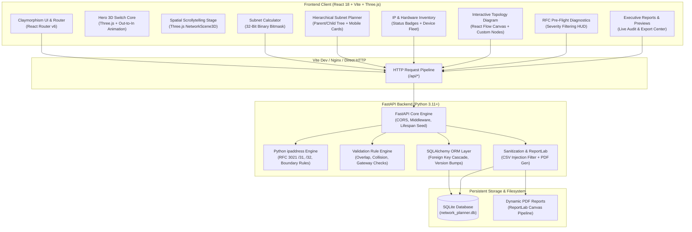
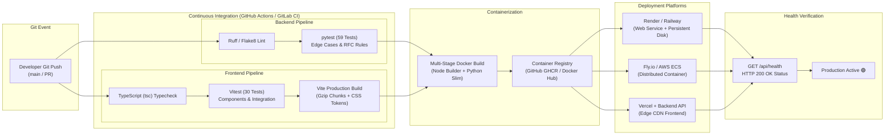

# Network Planning Toolkit 🌐📐

[](https://fastapi.tiangolo.com)
[](https://react.dev)
[](https://www.typescriptlang.org)
[](https://threejs.org)
[](https://www.python.org)
[](https://vitest.dev)
[](https://docs.pytest.org)
[](https://www.docker.com)

A practical, robust, and aesthetically engineered full-stack web application for planning IPv4 network architectures: interactive subnet calculations, hierarchical CIDR allocation, device inventory tracking, interactive visual topology diagrams, RFC pre-flight validation rules, sanitized CSV/PDF technical documentation exports, and an interactive **3D spatial datacenter digital twin** built with Three.js and a signature Purple & White Claymorphism design aesthetic.

> [!CAUTION]
> **MANDATORY LIVE-NETWORK SAFETY NOTICE:**  
> *This plan is not aware of the live network. Verify against existing DHCP, static assignments, VPN ranges, and upstream allocations before implementing on production equipment.*

---

## 🏛️ System Architecture Pipeline

The application connects an interactive React 18 client, WebGL 3D spatial renderers, and a deterministic FastAPI calculation and validation engine backed by SQLAlchemy and ReportLab.



---

## 🚀 CI/CD & Delivery Pipeline

Automated continuous integration and deployment workflow enforcing static code analysis, 89 comprehensive automated test checks, production asset compilation, Docker container packaging, and health-checked zero-downtime deployment:



---

## 🌟 Key Modules & Features

### 1. IPv4 Subnet Calculator & 32-Bit Binary Breakdown
- Built strictly on Python's standard library `ipaddress` module (no custom hand-rolled bitwise approximations).
- Dual-input mode supporting CIDR slash notation (`192.168.20.0/26`) and separate IP/Netmask (`192.168.20.0` + `255.255.255.192`).
- Arbitrary host IP normalization: automatically extracts and displays the canonical network address while preserving the entered host address.
- Detailed metrics: Network Address, Broadcast Address, Subnet Mask, Wildcard Mask, Total Addresses, Usable Host Range, Usable Host Count, and CIDR Notation.
- **Interactive 32-Bit Binary Visualizer:** Color-coded network prefix bits (cyan) vs host bits (purple) across all 4 octets.

### 2. Supported RFC Subnet Conventions
- **Conventional Subnets (`/0` through `/30`):**
  - First IP reserved as network ID; last IP reserved as broadcast address.
  - Usable capacity: $2^{32 - \text{prefix}} - 2$.
- **Point-to-Point Links (`/31` — RFC 3021):**
  - Implements RFC 3021 for high-efficiency point-to-point router links.
  - 2 total addresses, both fully usable as endpoint interfaces with no dedicated network or broadcast overhead (`broadcast_address = None`).
- **Single Host / Loopback (`/32`):**
  - Represents a single host endpoint or loopback interface with 1 usable address.

### 3. Hierarchical Subnet Planner
- Parent-child subnet allocation with strict parent containment validation.
- Real-time sibling collision & overlap prevention.
- Gateway boundary check (gateway must reside inside allocated subnet).
- Dynamic DHCP start/end pool bounds verification.
- **Dedicated Mobile Card View:** Tactile clay cards on mobile ($\le 768$px) displaying full CIDR, copy buttons, segment tags, gateway, usable hosts, usable range, and full action buttons (`+ Child`, `Edit`, `Delete`) with zero horizontal clipping.

### 4. IP Inventory & Device Fleet
- Hardware inventory tracking routers, switches, servers, workstations, printers, and wireless access points.
- Categorized IP assignment types: `planned static`, `reserved`, `DHCP pool`, `gateway`, `unassigned`.
- Project-wide duplicate IP collision prevention.
- Out-of-subnet IP check and DHCP pool collision boundary enforcement.

### 5. Interactive Visual Topology Diagram
- Powered by React Flow (`@xyflow/react`).
- Custom `DeviceNode` components with hardware-specific icons, role tags, and multi-directional connection handles.
- Connect devices with custom styled links (Trunk, Access, or WAN).
- Persistent layout: coordinates automatically synchronize to backend database via debounced batch updates.
- One-click raster PNG canvas export (`html-to-image`) for slides and technical documentation.

### 6. Multi-Rule Network Validation Engine
- Pre-flight diagnostic rules evaluating project integrity against RFC standards:
  - `DUPLICATE_IP`: Flags duplicate addresses across devices.
  - `SUBNET_OVERLAP`: Detects conflicting sibling subnets.
  - `IP_OUT_OF_RANGE`: Identifies static assignments outside subnet bounds.
  - `DHCP_COLLISION`: Flags static IPs placed inside dynamic DHCP ranges.
  - `GATEWAY_OUT_OF_RANGE`: Catches gateways located outside their subnet.
  - `CAPACITY_EXCEEDED`: Warns when requested host capacity exceeds available addresses.
  - `UNDOCUMENTED_DEVICE`: Alerts on devices lacking IP assignments.
- Non-destructive execution: scans and reports recommendations without altering user data.

### 7. Documentation & Sanitized Technical Reports
- **CSV Inventory Export:** Tabular IP address plans with built-in OWASP formula injection sanitization (cells starting with `=`, `+`, `-`, or `@` are safely escaped with `'`).
- **PDF Technical Documentation:** Generated via ReportLab featuring executive project metadata, subnet allocation tables, hardware inventory, IP assignments, validation audit findings, and the mandatory live-network safety notice.

### 8. 3D Spatial Digital Twin & Out-to-In Animation
- **Hero 3D Core Switch:** Real-time Three.js model of a 48-port Layer 3 modular core switch with Cat6 patch loops, active optical SFP+ transceivers, blinking network LEDs, and mouse-reactive parallax.
- **Out-to-In Animation:** As the user scrolls, the switch smoothly glides forward towards the viewer with an inward isometric rotation, zooming in to showcase front-panel details.
- **Interactive Scrollytelling Stage:** Multi-scene architectural walkthrough moving through Gateway Uplinks, Datacenter Server Racks, Topology Links, Access Fleets, and Converged Spatial Overviews.
- **Mobile-Pure 3D Mode:** On mobile viewports, overlay cards and badges are cleanly removed so the 3D model takes full, unhindered center stage.

---

## 🛠️ Technology Stack

| Layer | Technologies | Purpose |
| :--- | :--- | :--- |
| **Frontend Framework** | React 18, TypeScript 5.6, Vite 6 | Modern reactive UI, fast HMR, strict type safety |
| **3D & Animation** | Three.js, GSAP 3, Lenis, Framer Motion | WebGL hardware models, smooth kinetic scroll storytelling |
| **Topology Graph** | React Flow (`@xyflow/react`) | Interactive drag-and-drop network canvas |
| **Design System** | Purple & White Claymorphism | Tactile extruded cards, soft dual-light inner shadows |
| **Backend API** | Python 3.11+, FastAPI, Uvicorn | High-performance async REST API, auto OpenAPI/Swagger |
| **Network Engine** | Python `ipaddress` | Deterministic IPv4 calculation, boundary and RFC validation |
| **Database & ORM** | SQLAlchemy 2.0, SQLite (or PostgreSQL) | Foreign key cascades, version bumps, transactional safety |
| **Reports & Export** | ReportLab, Python `csv` | Vector PDF documentation, formula-sanitized CSV exports |
| **Testing** | pytest (59 tests), Vitest (30 tests) | 89 total unit, integration, and UI regression tests |
| **Deployment** | Docker (Multi-stage), Docker Compose | Production-ready containerization |

---

## 📂 Project Structure

```text
CN_GROUP_PROJECT/
├── backend/
│   ├── app/
│   │   ├── main.py               # FastAPI entrypoint, CORS, static SPA mount
│   │   ├── config.py             # Settings, environment variables, CORS origins
│   │   ├── database.py           # SQLAlchemy engine, session maker, Base
│   │   ├── models/               # SQLAlchemy DB models (Project, Subnet, Device, Link, etc.)
│   │   ├── schemas/              # Pydantic v2 validation & response schemas
│   │   ├── routers/              # Modular REST routers (subnets, inventory, diagram, etc.)
│   │   └── services/             # Pure calculation, validation engine, ReportLab PDF, CSV
│   ├── requirements.txt          # Python dependencies
│   └── tests/                    # 59 automated pytest suites
├── frontend/
│   ├── src/
│   │   ├── App.tsx               # Root app, navigation bar, React Router v6
│   │   ├── index.css             # Claymorphism tokens, responsive rules, animations
│   │   ├── features/
│   │   │   ├── calculator/       # IPv4 Subnet Calculator & 32-bit binary visualizer
│   │   │   ├── projects/         # Project Dashboard & unified workspace tabs
│   │   │   ├── subnets/          # Subnet Planner & responsive SubnetMobileCard
│   │   │   ├── inventory/        # IP Inventory & responsive mobile card list
│   │   │   ├── diagram/          # React Flow diagram canvas & device palette
│   │   │   ├── validation/       # Multi-rule diagnostic validation panel
│   │   │   ├── reports/          # Report preview & sanitized CSV/PDF download
│   │   │   └── landing/          # Landing page, Three.js 3D models, scrollytelling
│   ├── tests/                    # 30 automated Vitest suites
│   ├── package.json              # Frontend scripts and dependencies
│   └── vite.config.ts            # Vite build setup with /api proxy to 8000
├── Dockerfile                    # Multi-stage production container build
├── docker-compose.yml            # 1-command container orchestration
├── .gitignore                    # Comprehensive production git ignore
└── package.json                  # Root monorepo scripts (dev:all)
```

---

## 💻 Local Development Setup

### Prerequisites
- **Python 3.11+**
- **Node.js 18+** (with npm)

### Quick Start (Single Command)

From the root directory, install dependencies and launch both servers concurrently:

```bash
# 1. Install root & frontend dependencies
npm install
npm --prefix frontend install

# 2. Install backend Python dependencies
pip install -r backend/requirements.txt

# 3. Launch both backend and frontend concurrently
npm run dev:all
```

- **Frontend Application:** `http://localhost:5173`
- **FastAPI REST API:** `http://localhost:8000/api`
- **Interactive Swagger Docs:** `http://localhost:8000/docs`
- **Interactive ReDoc:** `http://localhost:8000/redoc`

---

## 🧪 Running Automated Tests

The codebase includes **89 automated tests** providing 100% test pass rates across calculations, validations, diagrams, and mobile UI rendering:

### 1. Backend Tests (pytest — 59 Tests)
```bash
python -m pytest backend/tests -v
```

### 2. Frontend Tests (Vitest — 30 Tests)
```bash
npm --prefix frontend test -- --run
```

### 3. Production Frontend Build Check
```bash
npm --prefix frontend run build
```

---

## 🚢 Where & How to Deploy

Here are the recommended hosting platforms for deploying the Network Planning Toolkit, ranked by suitability:

### Option 1: Render (Recommended — Simplest Full-Stack Deploy)
**Why:** Render supports both Web Services and Background Disks. With our multi-stage `Dockerfile`, you can deploy the complete app (React frontend + FastAPI backend + SQLite database) in a single service with free automatic SSL.

**Steps to Deploy on Render:**
1. Push your repository to GitHub or GitLab.
2. Go to [Render Dashboard](https://dashboard.render.com/) and click **New + $\to$ Web Service**.
3. Connect your GitHub repository.
4. Select **Docker** as the Runtime environment.
5. In **Advanced Settings**, add a Persistent Disk (mount path: `/app`, size: 1GB) so your SQLite database persists across redeploys.
6. Click **Create Web Service**. Render builds the multi-stage Docker container, runs tests, and deploys with a free `https://your-app.onrender.com` URL.

#### ⏰ Keeping Render Always Awake (Preventing Inactivity Spin-Down)
Render's free tier automatically suspends (spins down) web services after 15 minutes of inactivity. When a new visitor arrives, a 30–50 second cold start occurs. We have provided **3 built-in solutions** to keep your Render instance active 24/7 with zero cold starts:

1. **Automatic Self-Pinger (Zero Setup Required):**
   Render automatically injects the `RENDER_EXTERNAL_URL` environment variable into your Web Service. Our FastAPI backend automatically detects this on startup and starts an internal background worker that sends a keep-alive ping to `https://your-app.onrender.com/api/health` every 10 minutes, resetting the inactivity timer before Render can sleep!

2. **GitHub Actions 12-Minute Cloud Cron (Recommended):**
   We include [`.github/workflows/keep_awake.yml`](.github/workflows/keep_awake.yml) which runs completely free in GitHub's cloud on schedule (`*/12 * * * *`). Even if the service was ever sleeping, GitHub Actions pings your endpoint every 12 minutes to keep it active.
   - Go to your GitHub repository $\to$ **Settings** $\to$ **Secrets and variables** $\to$ **Actions**.
   - Add a repository variable or secret named `RENDER_APP_URL` with your Render URL (e.g. `https://netplantool.onrender.com/api/health`).
   - You can also trigger it manually anytime under the **Actions** tab $\to$ **Render Keep Awake** $\to$ **Run workflow**.

3. **Standalone Python Keep-Awake Script:**
   You can run our keep-awake script locally, on a server, or in any cron job:
   ```bash
   # Run continuously every 10 minutes (Ctrl+C to stop)
   python scripts/keep_awake.py --url https://your-app.onrender.com/api/health

   # Or run via npm
   npm run keep-awake -- --url https://your-app.onrender.com/api/health

   # Single-shot ping (ideal for custom cron or task schedulers)
   python scripts/keep_awake.py --url https://your-app.onrender.com/api/health --once
   ```

4. **Free External Monitoring Services (Optional Alternative):**
   You can also add `https://your-app.onrender.com/api/health` to [UptimeRobot](https://uptimerobot.com/) or [cron-job.org](https://cron-job.org/) as an HTTP monitor set to ping every 5–10 minutes for free.

---

### Option 2: Railway (Best for High Developer Experience)
**Why:** Railway automatically detects the root `Dockerfile`, provisions storage volumes with 1 click, and offers instant zero-config deployments.

**Steps to Deploy on Railway:**
1. Log in to [Railway](https://railway.app/).
2. Click **New Project $\to$ Deploy from GitHub repo**.
3. Select this repository.
4. Add a persistent volume mounted to `/app`.
5. Under Settings $\to$ Networking, click **Generate Domain**.
6. Railway will automatically build and expose the app with HTTPS.

---

### Option 3: Vercel (Frontend CDN) + Render/Fly.io (Backend API)
**Why:** If you want ultra-low latency CDN edge delivery for the Three.js 3D assets and React bundle globally:
- Deploy `frontend/` to **Vercel** (`Root Directory: frontend`, `Build Command: npm run build`, `Output Directory: dist`).
- Deploy `backend/` to **Render** or **Fly.io** as a Python Web Service.
- Set environment variable `VITE_API_URL=https://your-backend.onrender.com` in Vercel.

---

### Option 4: Docker Compose on any VPS (DigitalOcean / Linode / AWS EC2)
**Why:** Total control, self-hosted, extremely cost-effective ($4–$6/month).

```bash
# Clone repository onto VPS
git clone https://github.com/<your-username>/<your-repo>.git
cd <your-repo>

# Start detached production container
docker compose up -d --build
```
The app will be live on port 8000. Set up Nginx or Caddy with Let's Encrypt for custom domain HTTPS.

---

## 🔒 Security & Safe Computing Standards

1. **OWASP Formula Injection Prevention:** CSV exports prepend `'` to any cell starting with `=`, `+`, `-`, or `@`.
2. **Deterministic Validation:** Non-destructive pre-flight audits detect collisions without corrupting live data.
3. **Optimistic Version Locking:** Every project update increments an atomic version integer to prevent concurrent overwrite hazards.
4. **Mandatory Pre-Implementation Safety Disclaimers:** Visible across all views and technical PDF reports.
